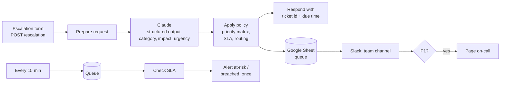

# Escalation Triage Automation (n8n + Claude)

**Every escalation in an AI data operation gets classified, prioritized, routed and put on an SLA timer in seconds, instead of waiting in a shared inbox for someone to read it.**

An n8n automation for the intake-and-escalation flow of an annotation / LLM-evaluation program. Claude classifies the issue, a tested policy assigns priority and SLA, the right team is notified, P1s page on-call, and a watchdog warns before an SLA is breached.

[Spec](SPEC.md) · [Runbook](docs/RUNBOOK.md) · [Workflows](n8n/) · [Golden set](samples/tickets.jsonl)

---

## The problem

In a 12-person squad, escalations ("the tool is down", "this guideline contradicts itself", "3 people are out sick") arrive by chat, email and DMs. Someone has to read each one, judge how bad it is, and forward it. Urgent issues wait behind trivial ones, and nobody knows an SLA is about to be missed until it already has.

I redesigned this flow at TELUS Digital with structured triage, which **cut average response time by 18%**. This repo is that design rebuilt as an automation.

## How it works



**The model classifies; the rules decide.** Claude only returns category, impact and urgency (plus a summary and confidence) in a fixed JSON schema. Priority, SLA, routing and paging come from [`policy.js`](workflow/policy.js), a short rules file that is unit-tested and auditable. An ops lead can change "P2 = 60 minutes" without touching a prompt.

| Impact ↓ / Urgency → | high | medium | low |
|---|---|---|---|
| **high** (team, site, client delivery) | P1 · 15 min | P2 · 1 h | P3 · 4 h |
| **medium** (several people, one batch) | P2 · 1 h | P3 · 4 h | P3 · 4 h |
| **low** (one person, one item) | P3 · 4 h | P4 · 24 h | P4 · 24 h |

### Guardrails

- **Fail safe:** if Claude is down, times out or refuses, the ticket still gets logged and goes to human triage. It is never dropped.
- **Low confidence → human:** below 0.6 confidence the ticket goes to the triage channel flagged for review, and is never left at P4.
- **Untrusted input:** ticket text is wrapped in tags and truncated before it reaches the model; it can't change the routing rules, which live outside the prompt.
- **No alert spam:** the watchdog alerts once per status change (at risk → breached), tracked in the sheet.
- **Refusal fallback:** requests use the API's server-side fallback, so a safety-classifier decline is retried on a fallback model.

## Tested before deployment

| What | How | Result |
|---|---|---|
| Priority matrix, SLA timers, routing, breach detection | `node --test` on `policy.js` | 8 tests |
| **The exported n8n workflows themselves** | Code nodes are extracted from the JSON and run with mocked n8n inputs | 4 tests |
| Workflow wiring | `build.py` checks every connection points to a real node | on every build |
| Classifier quality | 24 hand-labeled tickets → accuracy per field, under-prioritized tickets, missed P1s | `make eval` |

The workflows are **generated** from `policy.js` and `classifier.json` by [`build.py`](workflow/build.py), so the logic in n8n is byte-for-byte the logic the tests check.

## Run it

```bash
make test            # 12 Node tests, no accounts needed
make build           # regenerate n8n/*.json from policy.js + classifier.json
make eval-mock       # pipeline check of the classifier evaluation
make eval            # real classifier accuracy on the golden set (ANTHROPIC_API_KEY, ~24 calls)
```

To deploy: import `n8n/escalation-triage.json` and `n8n/sla-watchdog.json` into n8n, add an **HTTP Header Auth** credential (`x-api-key: <your Anthropic key>`), Google Sheets and Slack credentials, set your sheet ID, and activate. Full steps in the [runbook](docs/RUNBOOK.md).

## Project structure

```
workflow/policy.js         priority matrix, SLA, routing, breach detection (single source of truth)
workflow/classifier.json   Claude prompt + JSON schema
workflow/build.py          generates and validates the n8n workflows
workflow/*.test.js         policy tests + tests that run the exported Code nodes
n8n/                       importable workflows
samples/tickets.jsonl      24 labeled escalations (golden set)
eval/evaluate.py           classifier accuracy vs golden set
docs/RUNBOOK.md            setup, operations and incident procedures
SPEC.md                    requirements with EARS acceptance criteria
```

**Stack:** n8n · Claude API (structured outputs) · JavaScript · Node test runner · Python · Google Sheets · Slack

*Sample tickets are synthetic. No client or employer data is used.*
